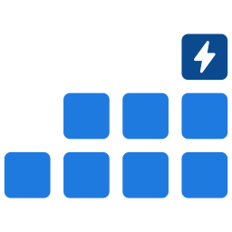
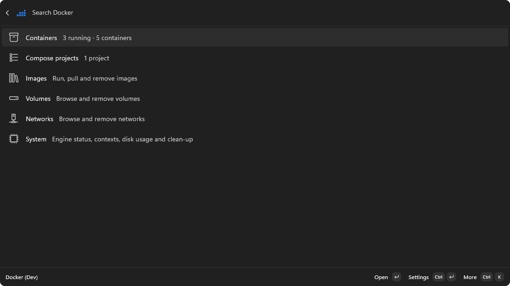
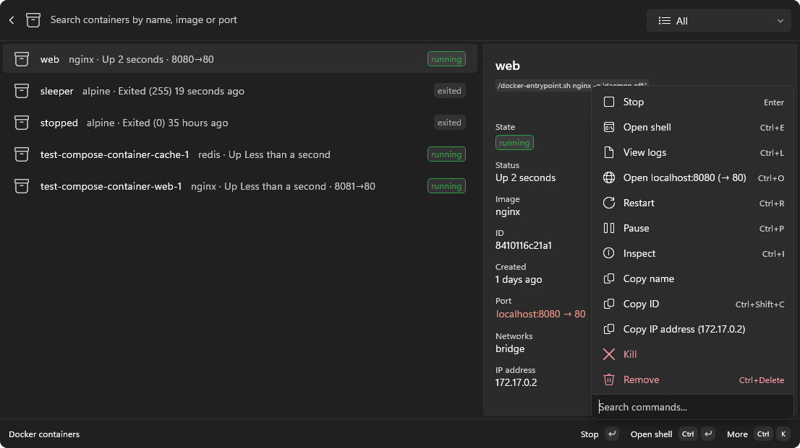
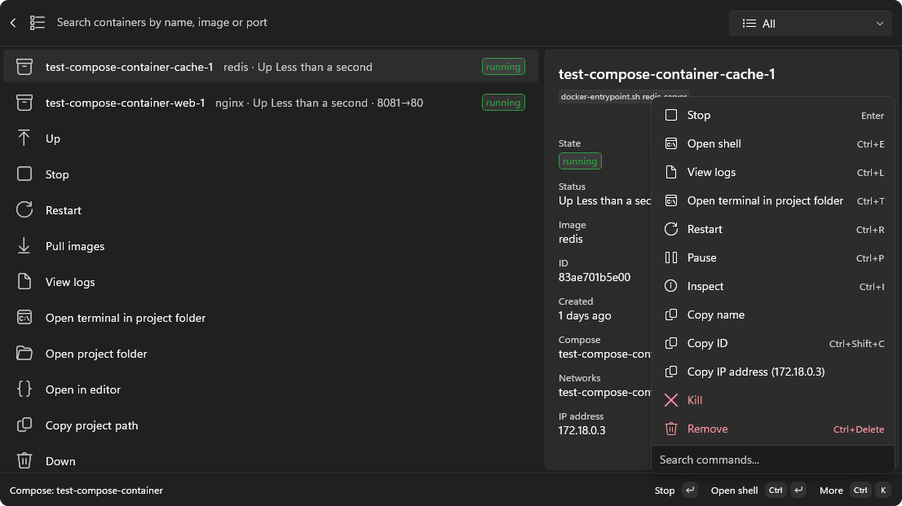
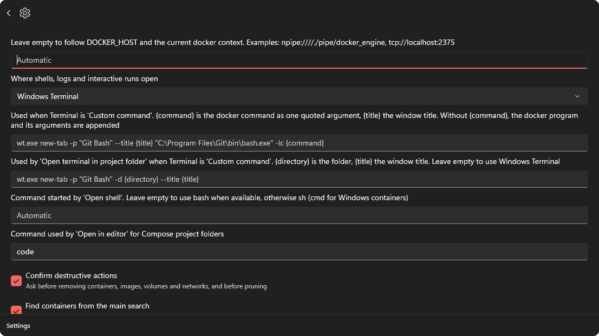

<div align="center">

<p>
	
</p>

<h1 align="center"><span style="font-weight: bold">Docker Extension</span> <br /><span style="font-weight: 300; opacity: 0.5">for Command Palette</span></h1>

<p align="center">
  <a href="https://github.com/BambinoSK/docker-ext-command-palette/blob/main/LICENSE"></a>
  <a href="https://github.com/BambinoSK/docker-ext-command-palette/releases"></a>
  <a href="https://github.com/microsoft/PowerToys"></a>
</p>

</div>

Manage your Docker containers, Compose projects, images, volumes and networks from PowerToys Command Palette, without opening Docker Desktop or a terminal.

> Unofficial. This extension is not affiliated with, endorsed by, or sponsored by Docker, Inc. Docker is a trademark of Docker, Inc.

## Screenshots

**Home page**



**Container actions**



**Compose project with its containers and actions**



**Settings**



## Features

- **Containers**: start, stop, restart, pause, resume, kill and remove. Filter by All, Running or Stopped. Lists update live as containers change.
- **Open a shell** in a running container (bash when available, otherwise sh) or **follow its logs** in your terminal
- **Open published ports** in your browser, and copy a container's name, ID or IP address
- **Inspect** a container: state, image, command, networks, mounts, environment and labels
- **Compose projects**: up, start, stop, restart, pull images, view logs and down. Open the project folder, open it in your editor, or open a terminal there to run your own `docker compose` commands.
- **Images**: run in a terminal, pull the latest version, remove, and clean up dangling or unused images
- **Volumes and networks**: browse, remove, and clean up unused ones
- **System**: engine version and disk usage, clean up containers, images, volumes and build cache, and switch the docker context
- **Find containers from the main search**: type a container's name in Command Palette's main search box
- **Start Docker Desktop** from the extension when the engine isn't running

### Keyboard shortcuts

| Shortcut | Action |
|---|---|
| `Enter` | Start a stopped container, or stop a running one |
| `Ctrl` + `K` | All actions for the selected item |
| `Ctrl` + `E` | Open a shell in the container |
| `Ctrl` + `L` | View logs |
| `Ctrl` + `O` | Open the container's first published port in the browser |
| `Ctrl` + `R` | Restart (on images: run in a terminal) |
| `Ctrl` + `P` | Pause or resume a container (on images: pull latest) |
| `Ctrl` + `I` | Inspect a container |
| `Ctrl` + `Shift` + `C` | Copy ID |
| `Ctrl` + `Delete` | Remove |
| `Ctrl` + `U` | Compose: up |
| `Ctrl` + `S` | Compose: start a stopped project, or stop a running one |
| `Ctrl` + `T` | Open a terminal in the Compose project folder |
| `Ctrl` + `F` | Compose: open the project folder |
| `Ctrl` + `Shift` + `E` | Compose: open the project in your editor |

## Requirements

- Windows 10 (version 2004 or later) or Windows 11, x64 or ARM64
- [PowerToys](https://github.com/microsoft/PowerToys) with Command Palette enabled
- [Docker Desktop](https://www.docker.com/products/docker-desktop/), or another Docker engine reachable over a named pipe or TCP
- The `docker` CLI for shells, logs, Compose and context switching. Docker Desktop includes it.

## Install

Download the latest package from the [Releases](https://github.com/BambinoSK/docker-ext-command-palette/releases) page, or build it from source (see below).

After installing, open Command Palette and search for **Docker**.

## Settings

Open Command Palette settings and select the Docker extension:

| Setting | Default | What it does |
|---|---|---|
| Docker host | Automatic | Engine endpoint, for example `npipe:////./pipe/docker_engine` or `tcp://localhost:2375`. Empty follows `DOCKER_HOST` and the current docker context. |
| Terminal | Windows Terminal | Where shells, logs and interactive runs open: Windows Terminal, a console window, or a custom command |
| Custom terminal command | Empty | Command used when Terminal is set to Custom command (see below) |
| Custom terminal command for folders | Empty | Command used by Open terminal in project folder when Terminal is set to Custom command. Empty uses Windows Terminal. |
| Container shell | Automatic | Command started by Open shell. Empty uses bash when available, otherwise sh (cmd for Windows containers). |
| Editor command | `code` | Command used by Open in editor for Compose project folders |
| Confirm destructive actions | On | Ask before removing, killing, taking down and cleaning up |
| Find containers from the main search | On | Show matching containers in Command Palette's main search |
| Show details panel | On | Open the details panel next to lists |

### Custom terminal

In the custom command, `{command}` is replaced by the docker command as one quoted argument, and `{title}` by the window title. If the template has no `{command}`, the docker program and its arguments are added at the end.

Git Bash in Windows Terminal:

```
wt.exe new-tab -p "Git Bash" --title {title} "C:\Program Files\Git\bin\bash.exe" -lc {command}
```

PowerShell 7 in its own window:

```
pwsh.exe -NoExit -Command & {command}
```

**Open terminal in project folder** starts an interactive shell instead of a docker command, so it has its own template. `{directory}` is replaced by the project folder and `{title}` by the window title. Git Bash in Windows Terminal:

```
wt.exe new-tab -p "Git Bash" -d {directory} --title {title}
```

## Troubleshooting

**"Docker engine is not reachable"**
Start Docker Desktop (the extension offers **Start Docker Desktop**) and wait until it reports that the engine is running. If you use another engine, set **Docker host** in the settings.

**"The docker CLI was not found"**
Install Docker Desktop, or add the folder that contains `docker.exe` to your `PATH`. Restart PowerToys afterwards.

**A container stops right after starting**
The extension reports when a container exits right away. Use **View logs** (`Ctrl` + `L`) to see why.

**Open shell says "the input device is not a TTY"**
Your custom terminal doesn't provide a Windows console. Run the shell inside Windows Terminal, or prefix the command with `winpty`.

## Privacy

The extension talks only to your local Docker engine. It has no analytics or telemetry. Details are in [PRIVACY.md](PRIVACY.md).

## Building from source

You need the .NET 10 SDK and Visual Studio with the Windows App SDK workload.

Build the solution:

```
dotnet build DockerExtension.sln -c Debug -p:Platform=x64
```

Run the tests:

```
dotnet test DockerExtension.Tests/DockerExtension.Tests.csproj -p:Platform=x64
```

Raise the package version before a release:

```
.\scripts\bump-version.ps1          # patch, or: minor, major, 1.2.3
```

## License

[MIT](LICENSE)
